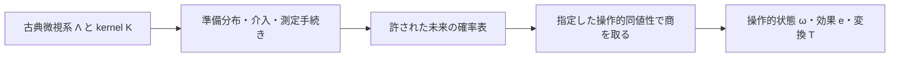

# 操作的状態と古典微視モデル

## 1. 何を一つの系と呼ぶか

選択した神経部分系または CNS 全体を、境界の定まった一つの入出力装置として扱う。外部の未観測入力、内部可塑性、遅延などが未来の統計を左右するなら、それらも状態か明示的な外部過程に含める。ニューロンごとの GenProbTheory やテンソル積構成は仮定しない。

完全な古典微視状態を可測空間 $(\Lambda,\Sigma)$ 上の $\lambda_t$ とする。一般の LIF 型なら

$$
\lambda_t=(V_i,g_i^E,g_i^I,r_i,\text{synaptic variables},\text{delay queues},\ldots)_{i=1}^N.
$$

これは一般的な例示である。現行コードの $g_i$ は電圧単位の符号付き単一変数であり、別々の興奮・抑制コンダクタンスではない。[05](05_connectome_mapping.md) で実装との差を記録する。

入力を $a_t$ と書く（単位効果 $u$ と区別）。微視発展は

$$
K_a(d\lambda'\mid\lambda),\qquad
\mu_{t+1}(A)=\int_\Lambda K_{a_t}(A\mid\lambda)\mu_t(d\lambda).
$$

決定論なら $K_a(\cdot\mid\lambda)=\delta_{f_a(\lambda)}$ でよい。非線形な $f_a$ でも分布への写像 $K_a\mu$ は線形である。真の乱数を積分した Markov 記述と、疑似乱数器の内部状態まで含む決定論的プログラム記述の両方が可能である。外から履歴依存の入力を与える場合は、その制御器の状態も明示する。

## 2. 手続きの定義

準備 $P\in\mathcal P$ は初期分布 $\mu_P$ を実現する再現可能な手続きである。静止へのリセットや感覚入力履歴などが候補だが、任意の $\lambda$ を書き込めるとはしない。

変換 $\tau\in\mathcal T$ は指定された時間幅の入力・介入と、それに対応する古典 kernel $K_\tau$ である。刺激波形、継続時間、許されるフィードバックを手続きの一部として記録する。測定 $M\in\mathcal M$ は outcome $o$ を返す kernel $m_M(o\mid\lambda)$ で、各 $\lambda$ で非負かつ $\sum_o m_M(o\mid\lambda)=1$ とする。

$$
p(o\mid P,\tau_n\circ\cdots\circ\tau_1,M)
=\int m_M(o\mid\lambda_n)
K_{\tau_n}(d\lambda_n\mid\lambda_{n-1})\cdots
K_{\tau_1}(d\lambda_1\mid\lambda_0)\mu_P(d\lambda_0).
$$

発火有無、一定時間窓の集団発火数の閾値、運動出力カテゴリなどを測定候補とする。時間窓全体の spike を読むときは終端の電位だけの関数には通常ならない。窓内過程を積分した $m_M$、経路空間上のイベント、またはカウンタを加えた拡大状態で定義すればよい。

繰り返し測定で状態が変わる場合は instrument $K_{o\mid M}(d\lambda'\mid\lambda)$ を使う。これは各 outcome ごとの sub-Markov kernel で、和が確率保存 kernel になる。選別成功のみを残す解析には失敗 outcome と成功率も必要である。未来に測定結果で介入を変える場合、全ての許された適応的な実験木を以下の未来集合に含める。

## 3. 未来を含む操作的同値性

許された未来テスト全体を $\mathcal Q$ とする。テスト $q=(\tau_{1:n},M,o)$ は一つの確率 $p(q\mid P)$ を定める。identity、許された手続きの合成、測定結果の粗視化を含め、準備集合は許された変換後の準備も含むよう閉じる。

$$
P\simeq_{\mathcal Q}P'
\iff p(q\mid P)=p(q\mid P')\quad\forall q\in\mathcal Q,
\qquad\omega_P=[P]_{\mathcal Q}.
$$

ここで **$\lambda$ は装置の完全な微視状態、$\omega$ は許された未来の確率を指定する準備の同値類**である。通常 $\omega$ は単一の $\lambda$ の圧縮ではなく、準備が作る分布 $\mu_P$ のクラスである。異なる分布、異なる準備履歴が同じ $\omega$ を持ち得る。

prepare–measure だけの $\mathcal Q_0=\{(M,o)\}$ を使う場合は $\simeq_0$ と明記する。未来を増やすと同値関係は細かくなる。

$$
\mathcal Q_0\subseteq\mathcal Q_1
\ \Longrightarrow\ (P\simeq_{\mathcal Q_1}P'\Rightarrow P\simeq_{\mathcal Q_0}P').
$$

直後に二つのニューロン集団が無発火でも、潜在的な電位や synaptic drive の差を次の刺激が発火差に変えるかもしれない。これは $\simeq_0$ から未来同値性を推定できない理由である。即時発火率をそのまま逐次計算の十分状態としない。

## 4. 商上の変換が存在する条件と証明

**命題（未来閉包と商への降下）。** 任意の $q\in\mathcal Q$ と許された $\tau$ について「まず $\tau$、次に $q$」が $\mathcal Q$ に含まれ、$\tau P$ が許された準備なら

$$
T_\tau[ P ]=[\tau P]
$$

は well-defined である。

**証明。** $P\simeq P'$ なら、全ての $q$ に対して $p(q\mid\tau P)=p(q\circ\tau\mid P)=p(q\circ\tau\mid P')=p(q\mid\tau P')$。よって代表元の選び方に依存しない。準備の確率混合を許せば同じ式を積分に適用でき、$T_\tau$ は affine である。□

有限 horizon $H$ で切った同値性 $\simeq_H$ ではこの閉包は一般には破れる。正しい無条件の写像は、1 step の変換なら

$$
T_\tau:\Omega^{(H+1)}\longrightarrow\Omega^{(H)}
$$

である。$\Omega^{(H)}\to\Omega^{(H)}$ の定常モデルを主張するには別の閉包・十分性証明が要る。horizon を延ばしたときの予測失敗はこの仮定の反証になるが、有限回の成功は無限未来の証明ではない。

## 5. 効果と変換の同値性

未来テストに対応する outcome 手続きを $f$ とし、

$$
f\simeq f'\iff p(f\mid P)=p(f'\mid P)\quad\forall P\in\mathcal P
$$

で効果 $e_f=[f]$ を定める。unit は必ず生じる outcome、zero は不可能な outcome である。

変換については、全ての許された準備と未来テストで

$$
\tau\simeq\tau'\iff p(q\mid\tau P)=p(q\mid\tau'P)\quad\forall P,q
$$

とする。準備が前段の介入で到達する全ての状態を含めば、前後の文脈について十分である。付随する補助系・外部メモリを許す場合はそれらも文脈に含める必要があり、この定義だけから complete positivity や局所トモグラフィーを導かない。

これらの手続きの同値性と、ontic 分布・応答・遷移に同一性を要求する**一般化非文脈性の仮定**は別段階である。古典 kernel の存在自体は後者を保証しない。[03](03_classicality_and_contextuality.md) 参照。

## 6. 凸混合とラベル情報

準備の前に外部コインで $i$ を確率 $q_i$ で選び、そのラベルを将来の装置・測定者に渡さなければ

$$
\mu_P=\sum_i q_i\mu_{P_i},\qquad
\omega_P=\sum_i q_i\omega_{P_i}.
$$

これは状態の線形化を正当化する実験操作である。ラベルを保持して読出しを切り替えられる場合は別の系（古典フラグ付きの状態）になる。凸包の二つの分解が同じ $\omega$ かどうかは全許容未来で判定する。混合比が同じという理由だけで、微視分布や準備履歴を同一視してはいけない。

測定設定の乱択・outcome の古典的後処理にも同じ原理が適用できる。ただし独立に選んだ任意の有効効果の和が unit になるだけで、その測定が実装可能とは限らない。許された測定の outcome 構造も保持する。

## 7. 関係図と既存理論

元の古典理論の線形関係を保持した fragment から確率表だけの商へ進むことは、追加の同一視を生む場合がある。親 fragment、商、有限データでその商を推定したモデルを区別してラベル付けする。

未来実験の予測で状態を表す構造は predictive state representations（PSR）と直接関係する。操作的同値性と混合の尊重を使って古典表現の存在をさらに問う点を、既存の予測状態モデルに加える検査と位置付ける。定義自体は新規ではない。[^1] また fragment とその shadow の区別は既存の GPT 理論に基づく。[^2]

[^1]: Singh, James & Rudary, “Predictive State Representations: A New Theory for Modeling Dynamical Systems,” UAI (2004), [著者公開本文](https://web.eecs.umich.edu/~baveja/Papers/uai2004psr.pdf).
[^2]: Schmid et al., “Shadows and subsystems of generalized probabilistic theories: when tomographic incompleteness is not a loophole for contextuality proofs,” Quantum 9, 1880 (2025), [DOI](https://doi.org/10.22331/q-2025-10-13-1880).
