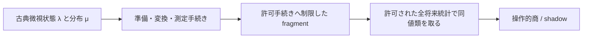

# 古典性、単体埋込み、制限インターフェース

本書の GPT は Generalized Probabilistic Theory（GenProbTheory）である。既存の量子・暗号研究から独立した理論文書であり、以下の人工例は MaleCNS、神経細胞、量子物理の実証ではない。結論を先に述べると、**古典的な準備・読出しを制限した後、そこで区別できない手続きをさらに同一視すると、単体非埋込みの操作的商が生じうる。しかし既存の線形関係を継承するだけの部分 fragment への制限は、単体埋込みを壊さない。** この二つを混同すると研究全体の意味が変わる。

## 1. 比較する五つの命題

| 命題 | 正確な意味 | ここから自動的には言えないこと |
|---|---|---|
| 古典的微視物理 | 微視状態 $\lambda\in\Lambda$、準備分布 $\mu_P$、古典遷移核 $K_T$、応答 $\xi_{o\mid M}$ で統計を生成する | 操作的等価な手続きを微視表現でも同一視できること |
| 古典的確率可模擬性 | 指定した入力・精度・時間範囲の出力分布を古典アルゴリズムで標本化・近似できる | 多項式時間、最適な費用、非文脈性、実物の古典物理性 |
| 状態空間が単体 | $\Omega=\operatorname{conv}\{v_1,\ldots,v_m\}$、頂点がアフィン独立 | 完全な古典理論であること。効果・変換集合も指定が必要 |
| 状態–効果の単体埋込み | 同じ有限古典標本空間への状態・効果の線形写像が確率、混合、規格化を同時保存する | $\Omega$ 自体が単体、埋込次元が操作的次元と同じ、変換まで非文脈的 |
| 一般化非文脈性 | 指定した操作的等価性を満たす準備・効果・必要なら変換に、等しい存在論的表現を割り当てられる | 任意のインターフェースへ変更しても同じ結論、古典模擬の高速性 |

これらは相互に独立という意味ではない。たとえば有限単体の状態空間とその上の任意の許可アフィン効果なら、頂点を存在論的状態として単体埋込みを作れる。一方、逆向きは後述の正例で否定される。微視的古典性と可模擬性から、商の非文脈性は従わない。

Spekkens の定義は、準備・測定・変換それぞれの操作的等価性を存在論的同一性へ写す条件を分ける。応答の決定論性を一般的な公理にはしない。[Spekkens 2005, Sec. II, DOI: 10.1103/PhysRevA.71.052108](https://doi.org/10.1103/PhysRevA.71.052108)

## 2. 状態–効果の単体埋込みを定義する

まず有限次元で、規格化状態のコンパクト凸集合 $\Omega\subset V$ と許可効果集合 $E\subset V^*$ が互いを分離する商表現を考える。$0,u\in E$、$u(\omega)=1$、各許可測定は $\sum_o e_o=u$ を満たす。制御された古典的混合と許可された結果の粗視化は表現に保存する。無制限効果仮説は置かない。

$\Delta_m=\{p\in\mathbb R^m:p_i\ge0,\sum_i p_i=1\}$ とする。ある有限 $m$ と線形写像

$$
\iota:V\to\mathbb R^m,\qquad
\kappa:V^*\to\mathbb R^m
$$

が存在して

$$
\iota(\Omega)\subseteq\Delta_m,\quad
\kappa(E)\subseteq[0,1]^m,\quad
\kappa(u)=\mathbf1,\quad
e(\omega)=\kappa(e)^\top\iota(\omega)
\tag{1}
$$

となるとき単体埋込み可能と呼ぶ。状態を単体の内部へ置くだけでは足りず、**効果の線形関係を保存した同一の $\kappa$** が必要である。両側が互いを分離するなら、確率保存は適切な張る空間上での単射性も保証する。一般の accessible fragment では状態と効果の張る空間を分け、退化しうる双線形確率則 $B$ を保持する。その段階で相互分離や単射性を勝手に要求しない。

既知定理：prepare–measure 操作理論に有限個の存在論的状態を持つ一般化非文脈的モデルがあることと、その操作的商が単体埋込み可能であることは同値である。非文脈モデルなら $\iota([P])=\mu_P$、$\kappa([e])=\xi_e$ が商上で定義でき、逆はこの写像を手続きへ合成すればよい。混合・粗視化の保存が線形性を与える。これは prepare–measure の定理であり、変換全体についての定理ではない。[Schmid et al. 2021, Theorem 1; Definitions/Theorems in Secs. VI–VII, DOI: 10.1103/PRXQuantum.2.010331](https://doi.org/10.1103/PRXQuantum.2.010331)

有限次元と有限存在論的標本空間は別の仮定である。有限観測表があるだけで、元の連続時間系や無限履歴の操作的状態が有限次元になるわけでもない。有限多面体 fragment では Selby らの錐分解による LP が利用でき、埋込みが存在する場合、存在論的状態数を $d_Sd_E$ 以下にできる（相互分離する $d$ 次元表現なら $d^2$）。ただし次元は規格化座標を含む線形次元である。有限集合で決めた等価性・錐・確率則への判定であり、未観測の生物学的全手続きへの判定ではない。[Selby et al. 2024, Supplemental Material C and E, DOI: 10.1103/PhysRevLett.132.050202](https://doi.org/10.1103/PhysRevLett.132.050202)

有限データの非負行列分解 $D_{ij}=\sum_\lambda \mu_i(\lambda)\xi_j(\lambda)$ だけでは不十分である。準備ラベルを $\lambda=i$ として $\mu_i=\delta_i,\xi_j(i)=D_{ij}$ とすれば非負分解自体は容易だが、準備混合の操作的等式を一般に破る。LP は正しい等式・効果関係・規格化を含む fragment を入力しなければならない。

## 3. restriction と quotient / shadow の区別

ここで矢印はすべて同じ種類の写像ではない。$P\mapsto\mu_P$ は準備の微視実装、$P\mapsto[P]=\omega_P$ は手続きの商である。一般に $\lambda$ 自身をそのまま $\omega$ と同一視できない。

**restriction の保存則（短い証明）。** 状態–効果 fragment $F$ が埋込写像 $(\iota,\kappa)$ を持つとする。状態・効果・測定を減らした $F'\subseteq F$ に同じ写像を制限すれば、非負性・確率保存・既存の線形関係はすべて保たれる。したがって新しい操作的等式を課さない単純な restriction は非埋込みを作らない。許可された混合・後処理にも、同じ線形写像で対応できる。

一方、少数の読出しに見えない方向を潰す追加の商は、新しい準備等式や効果等式を課す。その等式を既存の古典埋込みが保存する保証はない。有限表を最小ランクへ因子分解して得る理論は、この意味で元 fragment の shadow になりうる。

この問題は既知である。Schmid らは、任意の多面体 GPT がある古典単体理論の fragment の shadow として実現できることを示し、gbit の具体例を説明する（Theorem 20、Sec. 5.2）。また理論非依存トモグラフィーは shadow を再構成する（Theorem 22）。準備と効果が元の fragment に対して相互にトモグラフィー完全なら、shadow は元と同型であり判定が保存される（Theorems 19, 23）。従って「隠れた古典的自由度があるだけで、あらゆる非文脈性試験が無意味」とする結論も正しくない。[Schmid et al. 2025, Quantum 9, 1880, DOI: 10.22331/q-2025-10-13-1880](https://quantum-journal.org/papers/q-2025-10-13-1880/)

本研究では、親理論から継承した fragment を $\mathfrak F_{\rm inherited}$、制限された統計だけで商を取る対象を $\mathfrak F_{\rm op}$ と明示する。後者を研究対象とすることは数学的に可能だが、その非埋込みを前者や物理全体の非古典性へ移してはならない。「accessible fragment」という語だけで両者を済ませない。

## 4. 命題 A：非可換性は非古典性の証拠にならない

**命題・証明。** 古典三状態 $\{0,1,2\}$ 上で、$A$ は $0\leftrightarrow1$ を交換し、$B$ は $1\leftrightarrow2$ を交換する。それ以外は固定する。これらは置換行列、すなわち決定論的な確率遷移である。しかし

$$
AB\delta_0=\delta_1,\qquad BA\delta_0=\delta_2.
$$

従って $AB\ne BA$。完全な古典単体の状態・効果・変換モデルの内部で非可換性が起こるため、刺激順序依存だけから一般化文脈性も量子物理性も導けない。順序情報の保持という計算上の意味はありうるが、別の主張である。

## 5. 命題 B：非単体の状態形状だけでは不足する

**命題・構成的証明。** $\omega=(1,x,y)$、$-1\le x,y\le1$ を状態とする。この正方形は四つの極点を持つ二次元集合なので単体ではない。効果を

$$
u=1,\quad e_x(\omega)=\tfrac12+\tfrac14x,\quad
e_y(\omega)=\tfrac12+\tfrac14y,
\quad E=\operatorname{conv}\{0,u,e_x,u-e_x,e_y,u-e_y\}
$$

に制限する。次の写像を定める。

$$
\iota(1,x,y)=\tfrac14(1+x,1-x,1+y,1-y),
\tag{2}
$$

$$
\kappa(a+bx+cy)=(a+2b,a-2b,a+2c,a-2c).
\tag{3}
$$

状態像は古典四状態単体の断面
$p_1+p_2=p_3+p_4=1/2$ に入る。効果像は

$$
\kappa(e_x)=(1,0,\tfrac12,\tfrac12),\qquad
\kappa(e_y)=(\tfrac12,\tfrac12,1,0),
$$

であり、補事象・混合を含め $[0,1]^4$ 内にある。直接計算で $\kappa(e)^\top\iota(\omega)=a+bx+cy$、$\kappa(u)=\mathbf1$。よって状態と効果を同時に単体埋込みできる。

この構成は単なる図の包含より強い。**任意の古典単体の断面に全微視効果をそのまま付ければ非文脈的になる、とは言えない。** 断面上で新たに等価となる効果にも同じ応答を与える必要がある。ここでは式 (3) を明示してその問題を解決している。

対照として次節は同じ正方形に、より鋭い効果 $(1+x)/2,(1+y)/2$ を付ける。状態形状がまったく同じでも埋込みの可否は反転する。アフィンゲージを固定しない図の見た目は、これよりさらに弱い情報である。

## 6. 明示的な古典的反例：二ビット読出しの操作的商

### 6.1 微視的実装と許可手続き

微視状態を $\Lambda=\{00,01,10,11\}$ とする。$P_{ab}$ は $\lambda=(a,b)$ を決定論的に準備し、任意の外部ランダム混合も許可する。変換は恒等変換だけとする。測定 $M_1$ は第一ビット、$M_2$ は第二ビットを読む。各試行の測定は終端であり、**同じ個体に両測定を続けて実施する instrument、同時読出し、parity 読出し、準備乱数のラベルへのアクセスは許可しない。** 効果は二つのビット効果、補事象、零・単位効果とその古典的混合に閉じる。

この装置は二ビットの古典記憶だけで完全に実装できる。任意の将来変換列も恒等写像なので、この例に限って即時読出しと全許可将来読出しによる同値性が一致する。

$$
P_{\rm even}=\tfrac12P_{00}+\tfrac12P_{11},\quad
P_{\rm odd}=\tfrac12P_{01}+\tfrac12P_{10}
$$

は両ビットに同じ一様周辺分布を与えるため $P_{\rm even}\simeq P_{\rm odd}$。しかし微視分布は互いに素な支持を持ち、同一でない。商は

$$
\omega=(1,p_1,p_2),\quad (p_1,p_2)\in[0,1]^2,
\quad e_1(\omega)=p_1,\quad e_2(\omega)=p_2
$$

という正方形状態–効果理論になる。全微視分布 $\mu$ の線形射影
$q\mu=(\sum\mu,\mu_{10}+\mu_{11},\mu_{01}+\mu_{11})$
の核は $(1,-1,-1,1)$ が張る。これが失われた parity 方向である。

### 6.2 どの非文脈モデルも存在しないことの直接証明

既存の微視モデルが文脈的であるだけでは、別の非文脈モデルの不在は証明されない。そこで存在論的空間 $L$ を任意に取り、応答 $\xi_j(1\mid\ell)\in[0,1]$ と準備測度 $\nu_{ab}$ が統計を再現すると仮定する。

完全読出しより、$\nu_{ab}$ のほとんど全ての点で

$$
\xi_1(1\mid\ell)=a,\quad \xi_2(1\mid\ell)=b.
$$

これは平均が 0 または 1 という事実から従い、決定論性の追加仮定ではない。集合
$S_{ab}=\{\ell:\xi_1(1\mid\ell)=a,\xi_2(1\mid\ell)=b\}$
は互いに素で、$\nu_{ab}(S_{ab})=1$。準備非文脈性と外部混合の保存は

$$
\tfrac12(\nu_{00}+\nu_{11})=\tfrac12(\nu_{01}+\nu_{10})
\tag{4}
$$

を要求する。左辺は $S_{00}\cup S_{11}$ に確率 1、右辺は確率 0 を与え、矛盾する。従ってこの操作的商は単体非埋込みである。この反証は有限 $L$ に限定せず、確率測度と可測応答を持つモデルにも適用する。

### 6.3 有限雑音でも使える 3/4 境界の導出

一様入力 $a,b$ と一様な読出し選択 $j\in\{1,2\}$ に対して

$$
P_{\rm succ}=\tfrac18\sum_{a,b,j}p(o=(a,b)_j\mid P_{ab},M_j)
\tag{5}
$$

を定める。parity 混合同値と準備非文脈性を満たすモデルでは、存在論的状態 $\ell$ を条件にした入力の事後分布 $r_{ab}$ について

$$
r_{00}+r_{11}=r_{01}+r_{10}=\tfrac12.
$$

$\alpha=r_{00}+r_{01}-r_{10}-r_{11}$、$\beta=r_{00}+r_{10}-r_{01}-r_{11}$ と置くと

$$
r_{00}=(1+\alpha+\beta)/4,\quad
r_{01}=(1+\alpha-\beta)/4,\quad
r_{10}=(1-\alpha+\beta)/4,\quad
r_{11}=(1-\alpha-\beta)/4.
$$

非負性から $|\alpha|+|\beta|\le1$。$\ell$ を完全に知る最適な読出しでも条件付き成功率は

$$
\tfrac12\left(\tfrac{1+|\alpha|}{2}+\tfrac{1+|\beta|}{2}\right)
\le\tfrac34.
$$

存在論的状態について平均しても同じ境界が成り立つ。連続 $L$ では支配測度 $\tfrac14\sum_{ab}\nu_{ab}$ に対する密度で同じ事後分布を定義できる。第一ビットだけを送って第二ビットを一様に推測すれば境界は達成可能である。上の制限古典装置は $P_{\rm succ}=1$ を与えるが、微視状態に parity が記録されているため準備非文脈モデルではない。この $3/4$ 境界は parity-oblivious multiplexing の既知結果の二ビットの場合であり、本節はその計算を展開したもの。[Spekkens et al. 2009, Theorem 2, DOI: 10.1103/PhysRevLett.102.010401](https://doi.org/10.1103/PhysRevLett.102.010401)

比較用に正方形座標 $x,y\in[-1,1]$ の効果を $e_x=1/2+\eta x/2,e_y=1/2+\eta y/2$、$0<\eta\le1$ とすれば成功率は $(1+\eta)/2$。$\eta>1/2$ では境界を破る。$\eta\le1/2$ では式 (2) と応答 $(1/2+\eta,1/2-\eta,1/2,1/2)$ およびその $y$ 版が埋込みを与える。従ってこの**指定した雑音経路と指定した同値性**では閾値が正確に $\eta=1/2$ である。$\eta=0$ は全状態が同値となり商の次元自体が下がる。

### 6.4 何を示し、何を示さないか

この例は、古典四状態装置の制限された操作的商が単体非埋込みになりうることを示す。神経系の実例でも新規な数学的発見でもない。Holevo 型の gbit shadow と同種である。同時ビット読出し、連続した非破壊読出し、または parity を一ビットへ写す許可変換を追加すれば、even/odd 混合同値が壊れ、上の証明は適用できない。

「制限された受信者には parity を読めない」と「古典メッセージの微視状態自体に parity 情報がない」は異なる。この例を通常の古典通信資源に対する情報量・計算量上の優越と呼んではならない。

## 7. 命題 C：古典シミュレーションからの量子計算優越は導けない

**命題。** 既存 LIF/MaleCNS シミュレータの有限精度・有限時間実行が生成する統計を操作的 GPT で再記述しても、そのことだけから計算量理論的な量子計算優越は導けない。

**証明。** 元の古典プログラムが、同じ初期化・入力・乱数規則によって再記述前と同じ出力分布を生成する。座標変換や商はこの古典アルゴリズムの存在を消さない。したがって再記述だけでは古典比較クラスの不可能性証明にならない。これは実行費用がネットワークサイズに関して常に多項式、または最適であるという命題ではない。大きな古典計算費用や、特定の制約付き古典モデルに対する省メモリは別途定義・比較できる。連続実数モデルの無限精度計算まで可算の計算モデルに無条件で同一視しない。

## 8. 命題 D：制限された古典インターフェースの商が非埋込みとなる条件

**命題 D（既知理論と明示例に基づく条件付き命題）。** 有限次元の古典親 fragment と、それに追加の状態・効果同値性を課す線形商 $q_S,q_E$ を考える。

1. 親 fragment の埋込写像 $\iota,\kappa$ が商上へ降りる必要十分条件は、それぞれの定義域上で
   $$
   \ker q_S\subseteq\ker\iota,\qquad
   \ker q_E\subseteq\ker\kappa
   \tag{6}
   $$
   が成り立つことである。成立すれば $\iota=\bar\iota q_S,\kappa=\bar\kappa q_E$ と書け、商に埋込みがある。
2. 与えられた微視表現が式 (6) を満たさないだけでは、商の非埋込みは結論できない。他の存在論的表現の可能性が残る。商が非埋込みである必要十分条件は、商で要求される全線形同値関係・確率・非負性を満たす有限存在論的表現が**いずれも存在しない**ことである。有限多面体の場合は状態–効果 LP、または明示的な非文脈性不等式の違反がその証明手段になる。
3. 第 6 節の古典装置は条件 2 の不在を支持集合の矛盾で証明する。一方、第 5 節は新しい同値性に整合する写像を構成する。従って「古典親なら全商が埋込み可能」「制限すれば必ず非埋込み」のどちらも誤りである。

**証明。** 条件 1 は線形商の普遍性そのものである。たとえば $q_Sv=q_Sv'$ なら $v-v'\in\ker q_S$ なので、式 (6) の下で $\bar\iota(q_Sv)=\iota(v)$ は代表元によらない。商の状態・効果は元の像なので、規格化・非負性・確率保存も移る。逆に因子化すれば核包含は明らかである。条件 2 は式 (1) と準備–効果の非文脈モデルの対応、条件 3 は前節の証明による。これは「粗視化が資源を無料生成する」という一般定理ではなく、**追加の操作的同一視へ存在論的表現が因子化できるか**という条件である。

### 動力学が商上へ降りるための別条件

微視分布の線形空間 $W$ が全許可核 $K_a$ で不変であり、状態商 $q:W\to V$ を固定する。線形変換 $T_a$ が

$$
qK_a=T_aq
\tag{7}
$$

を満たす必要十分条件は

$$
K_a(\ker q)\subseteq\ker q
\tag{8}
$$

である。証明は条件 1 と同じで、$T_a(q\mu):=qK_a\mu$ の代表元独立性を調べる。許可された全有限将来列で準備同値性を定義し、その列集合が前に一つ入力を付ける操作に閉じれば、式 (8) が成立する。即時効果だけで取った商では成立しないことがある。

例：古典三状態 $0,1,2$ に対し即時読出しは $1$ だけを検出し、$0,2$ は区別しない。変換 $K$ が $0\mapsto1,2\mapsto2$ なら、即時には等価だった $\delta_0,\delta_2$ が変換後に区別される。即時商での $T$ は一価に定義できない。

最大将来長 $H$ の商 $q_H$ を採用する場合、一般に保証されるのは $q_{H-1}K_a$ が $q_H$ から定まることだけである。固定 $H$ の同じ状態空間に閉じる時間一様更新は別途検証する。全将来商は閉じても無限次元になりうる。

### strong lumpability は何を保証するか

有限微視空間の分割 $c:\Lambda\to Z$ を用いて、粗視分布を $(C\mu)(z)=\sum_{\lambda:c(\lambda)=z}\mu(\lambda)$ とする。すべての $a,z,z'$ と $c(\lambda)=c(\tilde\lambda)=z$ に対して

$$
\sum_{\lambda':c(\lambda')=z'}K_a(\lambda'\mid\lambda)
=\sum_{\lambda':c(\lambda')=z'}K_a(\lambda'\mid\tilde\lambda)
\tag{9}
$$

なら、共通値を $\bar K_a(z'\mid z)$ として $CK_a=\bar K_aC$ が成立する。これがここで使う strong lumpability の条件である。全初期分布に対して同じ粗視 Markov 核が使える必要十分条件であり、各 $\delta_\lambda$ に式を適用すれば必要性も分かる。特定初期分布だけで成立する弱い条件と区別する。

効果が $c$ の各ブロック上で一定なら、その粗視 Markov モデルは観測統計を再現する。さらに許可準備が $\mathbb R^Z$ を張り、許可効果がその分布を分離し、同じ空間で許可変換が閉じれば、$\Omega_Z\subseteq\Delta_{|Z|}$ と応答・核の標準表現は等価性を保存する。特に全粗視点状態とそれを区別する効果が許される場合は明白な非文脈的古典基準になる。

ただし lumpability だけでは、さらに準備・測定を制限して新しい混合等値を課した商の非文脈性は保証しない。第 6 節では微視核自体は恒等核であり Markov 的だが、失われるのは「微視点の分割」だけでは表せない**分布間の parity 関係**である。一般の操作的商を微視点のクラスタリングと同一視してはいけない。

## 9. 状態–効果から全変換の非文脈性へ飛躍しない

状態–効果の埋込みがあっても、各許可 $T$ に非負の確率行列 $\Gamma_T$ が存在して

$$
\iota(T\omega)=\Gamma_T\iota(\omega),\quad
\Gamma_{T_2\circ T_1}=\Gamma_{T_2}\Gamma_{T_1},\quad
\Gamma_{qT+(1-q)T'}=q\Gamma_T+(1-q)\Gamma_{T'},
\tag{10}
$$

かつ変換同値性を保存するとは限らない。規格化保存変換では列確率行列、終端選別を伴う instrument では各結果の劣確率核と結果和の規格化を使う。恒等変換・合成則も同じ存在論的空間で整合させる。真の変換非文脈性の試験はこれらの条件を扱う必要がある。

将来変換を効果へ吸収した $e\circ T_n\circ\cdots\circ T_1$ の prepare–measure fragment が非埋込みなら、その全逐次理論にも一般化非文脈モデルはない。しかし、それが埋込み可能という結果は全逐次理論の非文脈性の十分条件ではない。Phase 1 の状態–効果 LP が扱う主張の範囲はここまでである。

## 10. 本研究が守る判定の境界

* 「この制限インターフェースの操作的商は単体非埋込み」は、同値性・将来実験集合・混合規則・有限次元モデル・統計的不確実性を特定した主張として扱う。
* 「この生物の物理が古典理論に反する」「量子計算をする」は本研究から導かない。
* 許可効果を増やすと準備等価性が壊れうる。アクセス集合を増やしたときの判定は、同じ fragment の単純な包含か、追加で再商を取る操作かを区別する。
* 準備のランダム混合を物理的に許さないのに、データ解析だけで凸包の等価性を公理化しない。混合ラベルを記録する試行と捨てる試行も区別する。
* 正方形 shadow の存在は既知であり研究の新規性ではない。生物学的に根拠のあるアクセス制約と、制約に依存する幾何が計算能力を説明するかが未解決部分である。

数学的検算は [theory_examples/README.md](../../theory_examples/README.md) を参照。これは上の有限有理数例の確認であり、一般 LP、神経実装、経験的な文脈性検証ではない。
